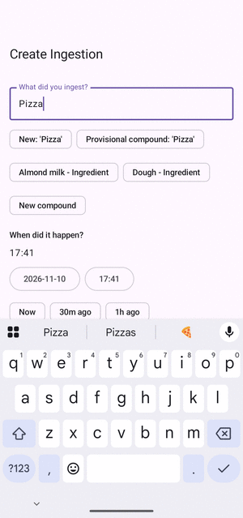
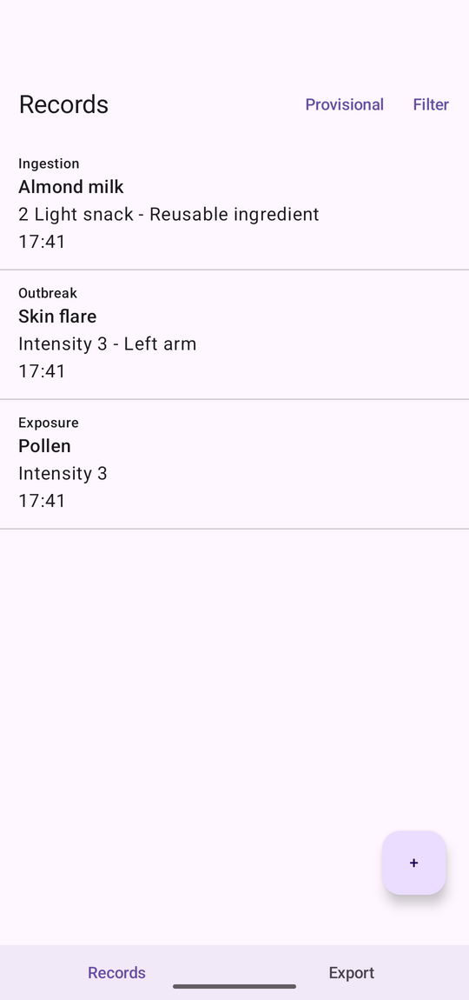
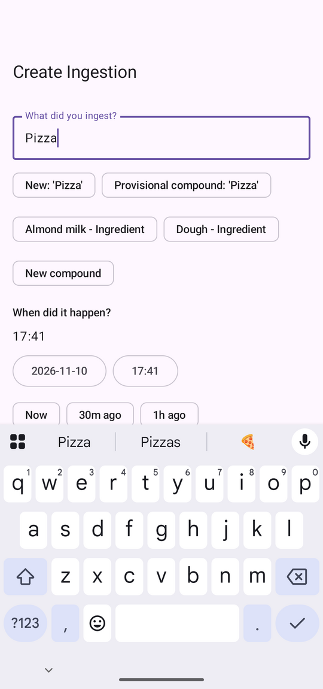
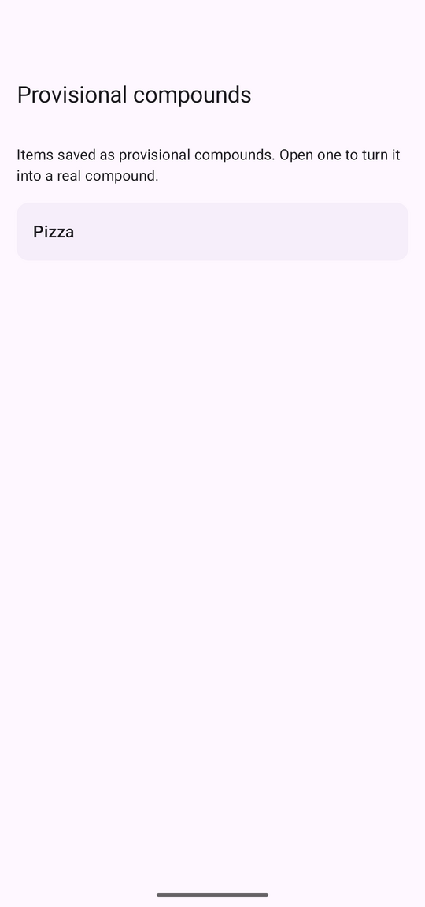
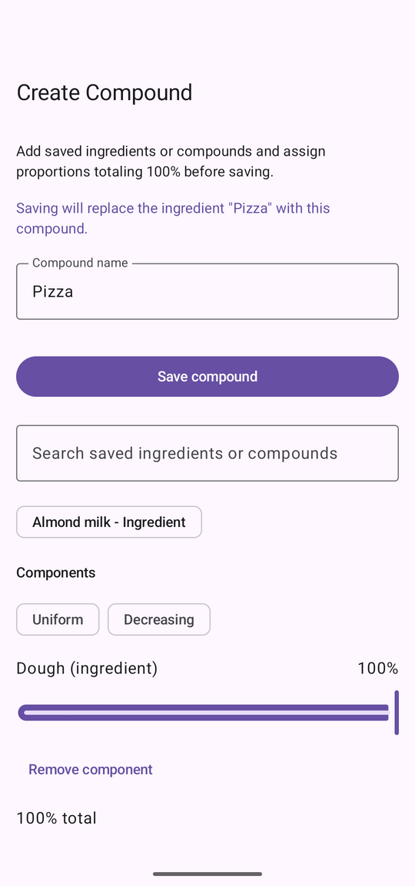
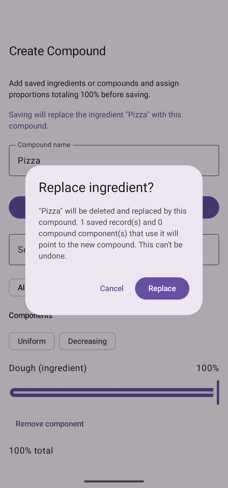
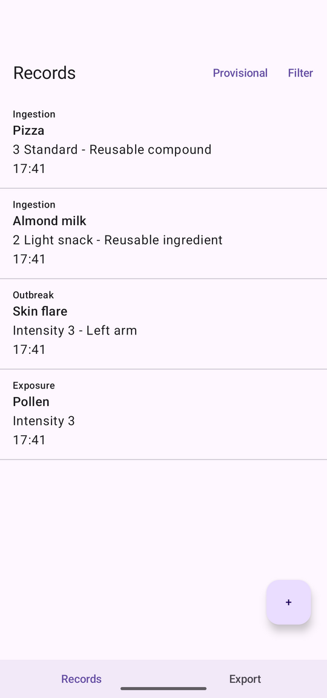
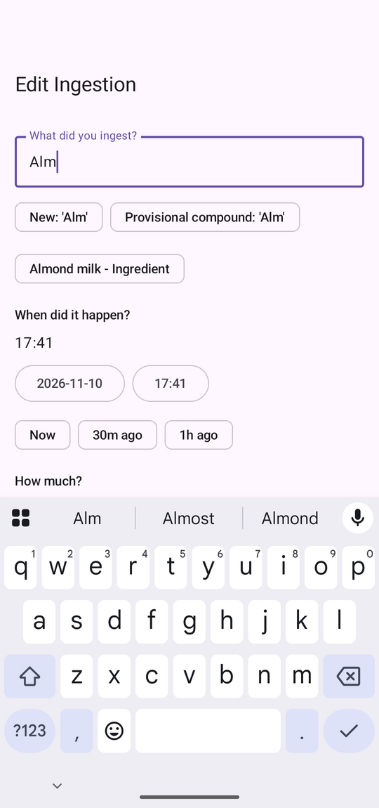
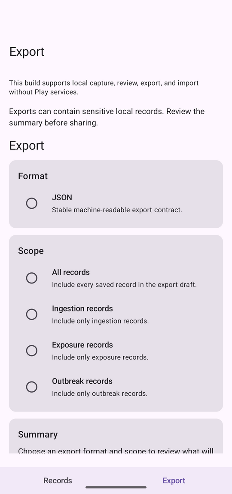

# Allergotracker

[](LICENSE)


An offline-first Android app for people with **delayed allergic reactions** who want to find likely triggers without relying only on broad, painful elimination diets. Log what you eat, what you were exposed to and when outbreaks happen, model the composite foods you actually eat, and export structured data for your own analysis.

Everything stays on your device. The app declares **no permissions** — not even internet access.

<p align="center">
  
</p>

## Screenshots

<table>
  <tr>
    <td align="center"><br><sub>Chronological records</sub></td>
    <td align="center"><br><sub>Capture with saved items</sub></td>
    <td align="center"><br><sub>Provisional compounds</sub></td>
    <td align="center"><br><sub>Turn an item into a compound</sub></td>
  </tr>
  <tr>
    <td align="center"><br><sub>Explicit confirmation before replacing</sub></td>
    <td align="center"><br><sub>Records relinked to the compound</sub></td>
    <td align="center"><br><sub>Correcting a record</sub></td>
    <td align="center"><br><sub>Explicit, versioned export</sub></td>
  </tr>
</table>

## What it does

- **Three kinds of records** — ingestions, exposures and outbreaks, each with date and time pickers, intensity and notes. Browse them in a single chronological list and filter by date, type and intensity.
- **Reusable ingredients and compounds** — save an ingredient once and reuse it everywhere. Build compounds from ingredients and other compounds with proportions that always add up to 100% (uniform and decreasing presets), with protection against circular compositions.
- **Provisional compounds** — don't know what is in the pizza yet? Save it as a *provisional compound* straight from the ingestion form. A list reachable from the Records bar keeps track of pending items so you can complete them later, or keep them as plain ingredients.
- **Make it a compound** — turn an ingredient into a real compound. The ingredient is replaced everywhere: saved records and other compounds that used it are repointed to the new compound, in a single transaction, after an explicit confirmation.
- **Safe maintenance** — merge duplicate ingredients and compounds with an impact preview, retire items with reference-aware handling, and correct historical records without breaking consistency.
- **Export and import** — export your records as a stable, versioned JSON contract, including relations and compounds normalized to their base ingredients; import structured compounds and datasets with validation.
- **Local control** — no account, no backend, no ads, no analytics.

## Privacy and offline posture

- All data is stored in a local database on the device. Nothing is sent anywhere because the app has no network permission.
- Exports are always started explicitly by you, and the app warns that exported files may contain sensitive health-related data.
- The project builds without Play services, Firebase, billing or other proprietary SDKs, and is intended to be distributable outside app stores.
- Note: Android's system backup is enabled in the manifest, so device-level backups made by Android may include the app's data depending on your device settings.

> **Not a medical device.** Allergotracker helps you organize observations. It does not diagnose, treat or provide medical advice, and it does not guarantee that any item is safe or unsafe. Talk to a qualified professional about your health.

## Download and install

Signed APKs are attached to each [GitHub Release](https://github.com/mateovich/allergotracker/releases).

1. Download `allergotracker-<version>.apk` from the latest release.
2. *(Recommended)* verify the checksum published in the release notes: `sha256sum allergotracker-<version>.apk`.
3. *(Recommended)* verify the signing certificate:
   `apksigner verify --print-certs allergotracker-<version>.apk` — the signer certificate SHA-256 must be
   `ec6e022e66bc2a6f63c102d92840d30fa3851329443ed8f4a8820c9369a5c52b`.
4. On your phone, allow installing from your browser or file manager when Android asks ("Install unknown apps"), then open the APK.

Direct APK installs don't update automatically: install a newer APK over the old one to upgrade (same signing key, your data is kept). The app is not published on Google Play.

Requires Android 9 (API 28) or newer.

## Local setup

- Java 17 available in `PATH` (`java -version`).
- Android SDK with platform 36 and platform tools (`adb version`).
- Use the Gradle wrapper (`./gradlew`), not a system Gradle.

## Build and run

Clone the repository and run `./gradlew :app:assembleDebug` to produce `app/build/outputs/apk/debug/app-debug.apk`, then install it with `adb install -r app/build/outputs/apk/debug/app-debug.apk` and launch it with `adb shell am start -n io.github.mateovich.allergotracker/.MainActivity`. For a signed release build, create a git-ignored `keystore.properties` at the repository root with the keys `storeFile`, `storePassword`, `keyAlias` and `keyPassword`, and run `./gradlew :app:assembleRelease`; without that file the release build is left unsigned.

```bash
./gradlew :app:assembleDebug              # debug APK
./gradlew :app:assembleRelease            # release APK (signed if keystore.properties exists)
./gradlew :app:testDebugUnitTest          # JVM unit tests
./gradlew :app:lintDebug                  # lint
./gradlew :app:connectedDebugAndroidTest  # instrumentation tests (device or emulator)
sh tests/run_all.sh                       # repository guardrail checks
```

## Under the hood

Kotlin, Jetpack Compose and Room, organized by feature (`features/...`, `core/...`, `navigation/...`) with `data → domain → ui` layers and ViewModels exposing `StateFlow`. Room schema export is enabled and every schema change ships with a migration and tests (currently database version 16).

## Project documents

- [ROADMAP.md](ROADMAP.md) — current priorities and deferred work
- [MAINTENANCE.md](MAINTENANCE.md) — maintenance expectations, support and security
- [CHANGELOG.md](CHANGELOG.md) — release history
- [LICENSE](LICENSE) — GNU General Public License v3.0

## AI-assisted development

Large parts of this project were written with the help of AI coding assistants under human direction. The code is covered by automated tests, but it handles health-adjacent personal data, so please review the code and its behavior yourself before relying on it, and report anything that looks wrong.

## License

Allergotracker is free software released under the [GNU General Public License v3.0](LICENSE).
